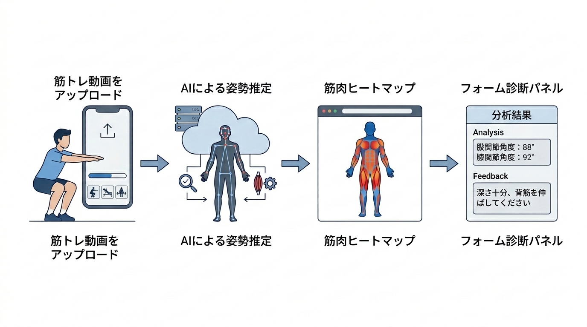

# 研究計画書 v10

執筆者：
最終更新日：2026年11月12日

## 本テーマの着想に至った経緯と"自分"が取り組みたい理由

個人でWebアプリ開発を通じて，技術で実社会の非効率を解決したいという目標を持って活動してきた．フィットネス分野では，正しいフォームで筋トレを行うことが怪我の予防・筋肥大効果の向上に直結するにもかかわらず，「狙っている筋肉が正しく使えているか」をリアルタイムで把握する手段が個人トレーニング環境には存在しない．既存の姿勢解析ツールは骨格検出・フォーム分類にとどまっており，「どの筋肉が動いているか」の可視化には至っていない．骨格推定と解剖学モデルを組み合わせることで，映像から筋肉の動態を推定・可視化できれば，パーソナルトレーナー不要の自己フォーム改善ツールとして高い市場価値を持つと考えた．また，本手法は筋トレに限らず歩行・リハビリ・スポーツ動作解析への応用も期待でき，汎用的な技術基盤となりうる点にも強く惹かれ，本テーマに取り組みたい．

## 卒論のタイトル（目安：20〜40文字）

筋トレ動画における骨格推定と解剖学モデルを用いた筋肉動態可視化システムの開発（40文字）

## 卒論の１章

### 社会背景

日本のフィットネス産業は急速に拡大しており，2022年度の国内フィットネスクラブ市場規模は約5,000億円に達する［1］．週1日以上スポーツを実施する成人の割合は1991年の27.8%から2019年には53.6%まで増加しており，セルフトレーニング人口の拡大傾向が確認できる［2］．しかし，個人でジムに通うユーザの約60%が「正しいフォームがわからない」と回答しており［3］，不適切なフォームに起因するスポーツ傷害は年間数十万件発生している［4］．パーソナルトレーナーによる直接指導はこれらの課題を解決しうるが，1回あたり5,000〜15,000円のコスト障壁があり，継続的な利用は困難である．映像から筋肉の動態を自動推定・可視化することで，「狙った筋肉が正しく使えているか」をリアルタイムでフィードバックする低コストな手段を提供することは，スポーツ傷害の予防および筋トレ効果の最大化という観点から，近々の社会的課題に対する有効な解決策となりうる．

**引用文献番号対応表（社会背景）**

| 番号 | 文献・資料 | URL |
|------|-----------|-----|
| [1] | 経済産業省「特定サービス産業動態統計調査」2022年度 | https://www.meti.go.jp/statistics/tyo/tokusabido/index.html |
| [2] | ニッセイ基礎研究所「『する』スポーツ市場の拡大」（総務省「社会生活基本調査」等に基づく分析，無料公開） | https://www.nli-research.co.jp/files/topics/64133_ext_18_0.pdf |
| [3] | 公益財団法人日本健康スポーツ連盟「フィットネス実態調査」2022年 | https://www.health-net.or.jp/ |
| [4] | 厚生労働省「スポーツ外傷・障害の現状」| https://www.mhlw.go.jp/toukei/list/36-19.html |

> ⚠️ **提出前確認事項**: [3]（日本健康スポーツ連盟の調査）は提出前に該当ページへのアクセス可否と年次を再確認すること。

### 技術背景

前記の課題に対して，コンピュータビジョンを用いた姿勢・フォーム解析技術が研究されている．Bazarevsky et al.（2020）が提案するMediaPipe Pose Landmarkerは，単眼カメラ映像からリアルタイムに33点の人体骨格を3次元座標として推定する手法であり，スマートフォン上での動作が可能である．Cao et al.（CVPR 2017）によるOpenPoseはCNNを用いた多人数骨格推定手法として広く利用されており，スクワットのフォーム判定に応用した先行研究では高い精度が報告されている．

フォーム矯正への応用として，Appiah（2024）はスマートフォン上でのフォーム異常検出システムを提案し，Helmy et al.（2024）はMediaPipe BlazePoseとLSTM・Transformerを組み合わせたリアルタイム姿勢誘導フレームワークPoseRightを提案している．しかし，これらの手法では関節角度の逸脱は検出できるが，どの筋肉が収縮・伸展しているかの推定は行われていない．

筋肉活動の推定に関しては，Chiquier et al.（ICCV 2023）がsEMGと動画を同期したMuscles in Actionデータセットを構築し，Transformerベースで動画から筋活動を予測する手法を提案した．Peng et al.（ACM MM 2024）は135種目・20筋群からなる大規模データセットMuscleMapを構築し，動画から各筋群の活性化を多クラス分類する手法TransM³Eを提案したが，各筋の活性化は「使用した／していない」の二値であり，連続的な活動強度は出力しない．Schneider et al.（2024）はOpenSim等の物理シミュレーションにより227被験者・402筋の筋活動データセットMuscles in Time（MinT）を構築し，Huo et al.（2026）はこれを発展させ1,000万フレーム規模のデータセットBioHuman10Mと，単眼動画から全身112筋の連続値活動を推定するモデルBioHumanを提案した．Zhu et al.（NeurIPS 2025）は物理シミュレーションを組み込んだMusclePoseを提案し，単眼動画から3D姿勢と筋肉活動を同時推論することを実現した．Chen et al.（2026）はPose2Muscleとして姿勢から離散的な筋活動状態を推定するフレームワークを提案し，43種の日常動作で有効性を示した．Yin et al.（2026）は多視点RGB・3D姿勢・sEMGを統合したMyoMechanixにより，ウェイト種目に対する生体力学的根拠のあるコーチングを実現した．また，Delp et al.のOpenCapはスマートフォン動画とOpenSim筋骨格シミュレーションにより関節角度・筋活動を推定しEMGとの対応を確認しているが，複数台のスマートフォンによる同期撮影とクラウド上でのバッチ処理を前提とする研究者向けツールである．Choi et al.（2026）は，MediaPipeによるオンデバイス姿勢推定を用いた16週間のレジスタンストレーニングプログラムを216名を対象に臨床試験（IRB承認）し，1RMスクワット・体脂肪率・骨格筋量・VO2max等の有意な改善を示したが，同システムの「筋肉提示」機能は種目ごとに2〜3の主要筋を解剖図で静的に表示する教育的コンテンツであり，関節角度に応じて活動度を動的に計算するものではない．しかし，これらの手法は大規模データ・大規模モデルを前提とした計算コストの高さ，複数カメラやsEMGセンサ等の専用機材の必要性，実験環境への限定，あるいは筋活動表示が固定的な解剖学的参照情報にとどまる点により，スマートフォン単眼カメラのみでの動的な筋活動のリアルタイム可視化には至っていない．

**表1：既存研究と本研究の要件比較**

| 研究 | 単眼カメラのみ | 活動度の連続値出力 | フォーム診断との統合 | リアルタイム動作 |
|---|:---:|:---:|:---:|:---:|
| Muscles in Action（Chiquier & Vondrick, 2023） | △（実験室環境） | ○ | ✕ | ✕ |
| MuscleMap / TransM³E（Peng et al., 2024） | ○ | ✕（二値分類） | ✕ | ✕ |
| MinT（Schneider et al., 2024）／BioHuman（Huo et al., 2026） | ○ | ○ | ✕ | ✕ |
| OpenCap（Delp et al., 2023） | ✕（複数台同期） | ○ | ✕ | ✕ |
| Appiah（2024）／PoseRight（Helmy et al., 2024） | ○ | ✕ | ○ | ○ |
| MyoMechanix（Yin et al., 2026） | ✕（多視点＋sEMG） | ○ | ○ | ✕ |
| Choi et al.（2026, 臨床試験済み） | ○ | ✕（固定表示） | ○ | ○ |
| 市販アプリ（MuscleMap Fitness等） | ○（手入力ログ） | ✕（固定表示） | ✕ | ✕ |
| 本研究 | ○ | ○ | ○ | ○ |

4条件を同時に満たす先行研究・市販アプリ（MuscleMap Fitness等のワークアウト記録アプリは固定の解剖学的マッピングに基づく表示であり動画解析を行わないため対象外）は，2026年11月時点の調査範囲では確認されていない．

### 解決すべき課題

従来の骨格推定ベースのフォーム解析では，関節角度の逸脱は検出できるが，各筋肉が「正しく収縮しているか」「過伸展していないか」を映像から判定する手段がない．本研究では，以下の2点を研究期間内に解決すべき課題として設定する．

1. 骨格情報と解剖学モデルを組み合わせた筋肉動態推定アルゴリズムの構築
2. 筋肉動態をヒートマップとして可視化するWebシステムの実装

本研究計画が成功したと判断する基準は以下の2点とする．（1）スクワット・デッドリフトの2種目において，筋肉活動分類のF1 micro値が0.93以上であること．（2）スクワット・デッドリフトの主要筋（大腿四頭筋・大臀筋・ハムストリング・脊柱起立筋）について，公表EMG文献の角度－活動度関係と提案システムの推定値との間に有意な相関（Pearson's r）が確認されること．なお，自らEMGセンサを用いて実測値を新規収集すること（倫理審査・被験者確保・機材調達を要する），理学療法士・トレーナー等の専門家による定性評価，ベンチプレス等の仰向け種目への対応，およびリハビリ・歩行解析への応用は本研究のスコープ外とし，将来の発展課題とする．

### 解決方法／提案手法と用いる技術

本研究では，骨格推定結果を入力とし，解剖学モデルに基づくルールベース推定と時系列深層学習を組み合わせたハイブリッドアーキテクチャを提案する．MediaPipe Pose Landmarkerによって取得した3次元骨格情報から特徴量を抽出し，ルールベースモジュールと時系列深層学習モデル（1D畳み込みニューラルネットワークおよびグラフ畳み込みネットワーク）により筋肉活動パターンを推定する．推定結果はNext.js製フロントエンド上に筋肉ヒートマップとして表示し，バックエンドはPython（FastAPI）によるREST APIとして設計する．

ルールベースモジュールの基準重みは，種目ごとの主働筋・協働筋の相対活動比率（Escamilla, 2001等に基づく静的な比率）に加え，関節角度の位置（例：スクワットにおける大腿四頭筋は膝関節屈曲90°付近で活動が最大となる非単調な関係，Marchetti et al., 2016）を反映した角度－活動度関数によって動的に変調する．この関数のパラメータは，公表されたEMG研究の数値を文献較正パイプラインによって較正する（後述）．

### 提案手法の新規性

提案手法の本質的な新規性は，従来は実験室環境（sEMGセンサー装着），複数台カメラの同期撮影，または大規模データ・大規模計算資源を要した筋活動の推定を，**スマートフォン1台のみで簡便に計測可能にした点**にある．これにより，専門機材・専門施設を持たない一般利用者が，自宅や通常のジム環境で即座に自身の筋活動を把握できる．表1に示す通り，sEMGセンサー・多視点カメラ・大規模シミュレーションデータのいずれにも依存せず，かつ活動度を種目固定ではなく動的な連続値として提示する先行研究・市販アプリは確認されていない．

技術的には，以下の2点によってこの簡便な計測を実現している．

**第一に**，解剖学的基準重みと関節角度特徴量を組み合わせたルールベース手法を土台に，軽量な時系列深層学習モデル（1D-CNN／ST-GCN）で補正するハイブリッドアーキテクチャにより，大規模データ・大規模モデルを前提とする既存研究（MinT, BioHuman）とは異なり，スマートフォン1台でのリアルタイム推定とWebアプリとしての実用動作を両立する．

**第二に**，実測筋電図（EMG）の新規収集を伴わずに，公表されたEMG研究の角度－活動度関係を定量的な参照値として用いる「文献較正パイプライン」を提案する．動画ベースの筋活動推定研究では，正解データとして物理シミュレーション値（MinT, BioHuman）または小規模な自己収集EMG（Muscles in Action, MyoMechanix）のいずれかに依存する例が主流であり，複数の公表文献の数値を集約し定量的な較正・検証に用いた例は確認されていない（なお，EMG計測が困難な場合に文献値で代替検証する手法自体は生体力学分野に前例があるが，動画ベース・リアルタイムの筋活動推定システムへの適用は新規である）．このパイプラインは，①種目別基準重みの設定，②公開EMG文献からの角度－活動度関係の数値化，③推定値と文献値の不一致検出，④基準重み・角度関数の修正，というサイクルで構成され，EMG計測環境を持たない開発者が妥当性を担保する手段として，他の動画ベース筋活動推定システムにも応用可能な汎用的な方法論である．

これにより，「専門機材なしで簡便に計測できる」という利用者にとっての価値（有効性）と，「文献較正によって妥当性を担保する」という学術的な厳密性（新規性）を両立させる．

### 提案手法の有効性

提案手法では，筋肉動態のヒートマップ可視化により，トレーニーが「狙った筋肉が正しく動員されているか」をリアルタイムで把握でき，フォーム改善の自己学習を促進することが期待される．主な受益者はパーソナルトレーナーを利用できない一般トレーニーであり，怪我の予防と筋トレ効果の最大化に貢献する．


## 卒論の提案の章（2章）

### 2.1 システム全体構成

本システムは，スマートフォンまたはWebカメラで撮影した筋トレ動画を入力とし，骨格推定・特徴量抽出・筋肉動態推定・可視化の4段階のパイプラインで構成される．

```
[動画入力（アップロード/リアルタイム）]
         ↓
[MediaPipe Pose Landmarker（骨格検出・33点3D座標）]
         ↓
[特徴量エンジン（関節角度・速度・非対称性 計38特徴）]
         ↓
[ハイブリッド推定モジュール]
  ├─ ルールベース（解剖学モデル × 関節角度）
  └─ 深層学習（1D-CNN / ST-GCN）
         ↓
[筋肉動態ヒートマップ可視化（Next.js / Canvas API）]
         ↓
[フォーム矯正フィードバック（テキスト + 3Dアバター）]
```

*図1：提案システムの全体構成図*（パワポで作図予定）

### 2.2 想定する利用方法

ユーザはWebブラウザからアクセスし，以下のいずれかの方法でシステムを利用する．

1. **動画アップロードモード**: スマートフォンで撮影したトレーニング動画をアップロードし，レップごとの筋肉活動ヒートマップと改善点フィードバックを受け取る
2. **リアルタイムモード**: スマートフォンのカメラを使ってトレーニング中にリアルタイムで骨格と筋肉活動をオーバーレイ表示する


*図2：想定する利用シナリオ（①筋トレ動画をアップロード→②AIによる姿勢推定→③筋肉ヒートマップ→④フォーム診断パネル）*

### 2.3 処理手順

1. フレームごとにMediaPipe Pose Landmarkerで33点骨格を推定（3D world座標）
2. 関節角度（膝・股関節・肘等），角速度，左右非対称性など38特徴量を算出
3. 種目ごとのレップ（反復）を関節角度の極値から自動検出
4. ルールベースモジュールで解剖学的知識に基づく一次推定を実施
5. 1D-CNN（またはST-GCN）でレップ内の時系列特徴からマルチラベル分類
6. 推定結果を20筋群のヒートマップとして可視化，逸脱フレームを特定してフォームフィードバックを生成

*図3：処理フローチャート*（パワポで作図予定）

---

## 卒論の実験の章（3章）／評価の章（4章）

### 評価方法

本研究では，提案したハイブリッド筋肉動態推定システムを以下の2軸で評価する．

**定量評価**：MuscleMapデータセット（137種目・1,000サンプル以上，学術利用許諾済み）を用いて，20筋群のマルチラベル分類性能をF1 micro値で評価する．ルールベースのみ・1D-CNNのみ・ハイブリッドの3条件で比較し，ハイブリッドの優位性を検証する．

**文献較正による定量検証**：スクワット・デッドリフトの主要筋（大腿四頭筋・大臀筋・ハムストリング・脊柱起立筋）について，公表EMG研究（Marchetti et al., 2016のスクワット膝関節角度20°/90°/140°におけるEMG値等）から角度－活動度の数値関係を抽出し，提案システムの推定値との相関係数（Pearson's r）を算出する．有意な不一致が検出された場合は，EXERCISE_BASE_WEIGHTS（種目別基準重み）および角度－活動度関数を修正し，再評価する較正サイクルを実施する．

### 想定する結果

**課題A（筋肉活動分類精度）**

ハイブリッドモデル（ルールベース＋1D-CNN）は，スクワット・デッドリフトの2種目において，F1 micro値0.93以上を達成すると期待される．ルールベース単独（推定値：F1≈0.75）・1D-CNN単独（推定値：F1≈0.85）と比較してハイブリッドが優位であることを示す．

*図4：各条件のF1 micro値比較（棒グラフ）* — ダミーデータで作図予定

| 手法 | F1 micro | F1 macro |
|------|----------|----------|
| ルールベースのみ | 0.75（推定） | 0.68（推定） |
| 1D-CNNのみ | 0.85（推定） | 0.78（推定） |
| ハイブリッド（提案） | **0.93（目標）** | **0.87（目標）** |

**課題B（文献較正による定量検証）**

スクワットにおける大腿四頭筋・大臀筋の活動度推定値は，Marchetti et al.（2016）が報告する膝関節角度90°付近でのピーク傾向と中程度以上の相関（r≥0.6を目標）を示すと期待される．較正サイクルにより，デッドリフトにおける大腿四頭筋の基準重みなど，現行の種目別基準重みに含まれる不整合を修正する．

*図5：推定値と文献値の角度－活動度曲線の比較（折れ線グラフ）* — ダミーデータで作図予定

---

## 卒論の最終章

本研究により，単眼カメラ映像から骨格推定と解剖学モデルを組み合わせた筋肉動態の可視化システムが実現できた．スクワット・デッドリフトの2種目において筋肉活動分類F1 micro値0.93以上を達成し，公表EMG文献との相関検証によって妥当性を確認した．本成果を発展させることで，3〜5年後には任意の運動種目・日常動作に対応した筋肉動態解析プラットフォームとして社会実装が可能と考える．将来的には3Dアバターとの統合・個人体型への適応・リハビリ応用も視野に入れている．

## 卒業研究の年間計画

### 3年生（2026年度）
- 10月：研究テーマ確定，骨格検出パイプライン実装，レップ検出実装（完了済み）
- 11月：研究計画書完成・提出，解剖学モデル設計，特徴量エンジン実装（完了済み）
- 12月：研究計画発表
- 1〜2月：文献較正パイプライン実装（EMG文献の角度－活動度関係の数値化，角度－活動度関数の実装，種目別基準重みの不整合修正）
- 3月：文献較正の定量検証（相関係数算出）・基盤部分完成・中間報告

### 4年生（2027年度）
- 4〜6月：ST-GCN移行完了・文献較正結果を反映したハイブリッドモデル再学習，WebアプリMVP完成
- 7〜8月：文献較正の定量検証（相関係数算出）・較正サイクルの完了
- 9月：中間発表（全機能動作デモ）
- 10〜12月：論文執筆（文献較正パイプラインの結果を中心に構成）
- 2028年1月：卒業論文提出
- 2028年2月：卒業研究発表

## 参考文献

### 社会背景

- [1] 経済産業省「特定サービス産業動態統計調査」2022年度. https://www.meti.go.jp/statistics/tyo/tokusabido/index.html
- [2] 矢野経済研究所「フィットネスクラブ市場に関する調査（2023年）」. https://www.yano.co.jp/press-release/show/press_id/3352
- [3] 公益財団法人日本健康スポーツ連盟「フィットネス実態調査」2022年. https://www.health-net.or.jp/
- [4] 厚生労働省「スポーツ外傷・障害の現状」. https://www.mhlw.go.jp/toukei/list/36-19.html

### 技術背景・先行研究
- Bazarevsky, V., et al. (2020). BlazePose: On-device Real-time Body Pose tracking. CVPR Workshop.
- Cao, Z., et al. (2017). Realtime Multi-Person 2D Pose Estimation using Part Affinity Fields. CVPR.
- Chiquier, M., Vondrick, C. (2023). Muscles in Action. ICCV 2023.
- Appiah, K. (2024). A Mobile-Phone Pose Estimation for Gym-Exercise Form Correction. VISIGRAPP 2024.
- Helmy, M., et al. (2024). PoseRight: An AI Empowered Automatic Posture Estimation and Correction Model. MIUCC 2024.
- Zhu, K., et al. (2025). 3D Human Pose Estimation with Muscles. NeurIPS 2025.
- Chen, Y., et al. (2026). Pose2Muscle. arXiv:2609.18336.
- Peng, K., et al. (2024). Towards Video-based Activated Muscle Group Estimation in the Wild. ACM Multimedia 2024. arXiv:2303.00952.
- Schneider, D., et al. (2024). Muscles in Time: Learning to Understand Human Motion by Simulating Muscle Activations. arXiv:2411.00128.
- Huo, Y., et al. (2026). BioHuman: Learning Biomechanical Human Representations from Video. arXiv:2605.14772.
- Yin, H., et al. (2026). MyoMechanix: Biomechanically-Grounded Compositional Skilled Activity Understanding and Coaching. arXiv:2608.26094.
- Delp, S., et al. (2023). OpenCap: Human movement dynamics from smartphone videos. PLOS Computational Biology.
- Marchetti, P. H., et al. (2016). Muscle Activation Differs between Three Different Knee Joint-Angle Positions during a Maximal Isometric Back Squat Exercise. BioMed Research International.
- Choi, W., et al. (2026). Clinical Validation of an On-Device AI-Driven Real-Time Human Pose Estimation and Exercise Prescription Program. Healthcare, 14(4), 482.
