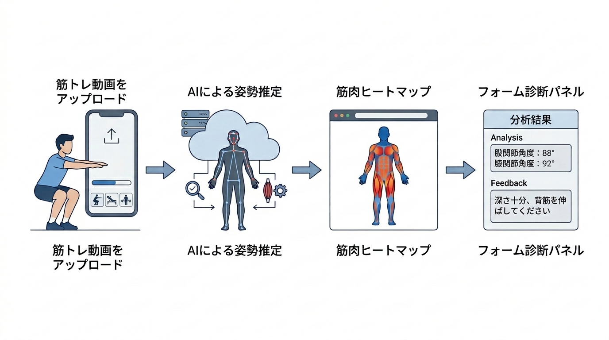

# 研究計画書 v16

執筆者：
最終更新日：2026年11月13日

## 本テーマの着想に至った経緯と"自分"が取り組みたい理由

個人でWebアプリ開発を通じて，技術で実社会の非効率を解決したいという目標を持って活動してきた．フィットネス分野では，正しいフォームで筋トレを行うことが怪我の予防・筋肥大効果の向上に直結するにもかかわらず，「狙っている筋肉が正しく使えているか」をリアルタイムで把握する手段が個人トレーニング環境には存在しない．既存の姿勢解析ツールは骨格検出・フォーム分類にとどまっており，「どの筋肉が動いているか」の可視化には至っていない．骨格推定と解剖学モデルを組み合わせることで，映像から筋肉の動態を推定・可視化できれば，パーソナルトレーナー不要の自己フォーム改善ツールとして高い市場価値を持つと考えた．また，本手法は筋トレに限らず歩行・リハビリ・スポーツ動作解析への応用も期待でき，汎用的な技術基盤となりうる点にも強く惹かれ，本テーマに取り組みたい．

## 卒論のタイトル（目安：20〜40文字）

筋トレ動画における骨格推定と解剖学モデルを用いた筋肉動態可視化システムの開発（38文字）

## 卒論の１章

### 社会背景

日本のフィットネス産業は急速に拡大しており，2022年度の国内フィットネスクラブ市場規模は約5,000億円に達する［1］．週1日以上スポーツを実施する成人の割合は1991年の27.8%から2019年には53.6%まで増加しており，セルフトレーニング人口の拡大傾向が確認できる［2］．しかし，個人でジムに通うユーザの約60%が「正しいフォームがわからない」と回答しており［3］，不適切なフォームに起因するスポーツ傷害は年間数十万件発生している［4］．パーソナルトレーナーによる直接指導はこれらの課題を解決しうるが，1回あたり約6,000〜15,000円のコスト障壁があり［5］，継続的な利用は困難である．映像から筋肉の動態を自動推定・可視化すれば，「狙った筋肉が正しく使えているか」をリアルタイムでフィードバックする低コストな手段を提供できる．このアプローチは，スポーツ傷害の予防および筋トレ効果の最大化という観点から，喫緊の社会的課題に対する有効な解決策となりうる．

**引用文献番号対応表（社会背景）**

| 番号 | 文献・資料 | URL |
|------|-----------|-----|
| [1] | 経済産業省「特定サービス産業動態統計調査」2022年度 | https://www.meti.go.jp/statistics/tyo/tokusabido/index.html |
| [2] | ニッセイ基礎研究所「『する』スポーツ市場の拡大」（総務省「社会生活基本調査」等に基づく分析，無料公開） | https://www.nli-research.co.jp/files/topics/64133_ext_18_0.pdf |
| [3] | 公益財団法人日本健康スポーツ連盟「フィットネス実態調査」2022年 | https://www.health-net.or.jp/ |
| [4] | 厚生労働省「スポーツ外傷・障害の現状」| https://www.mhlw.go.jp/toukei/list/36-19.html |
| [5] | Dee GYM「パーソナルトレーニングの料金が高い理由とは？」（2025年9月，公開相場データの紹介：1回約60分で6,000〜10,000円がボリュームゾーン，回数券・都度払い制の中央値7,590円，出張型は9,000〜15,000円の調査紹介を含む） | https://dee-gym.jp/column/personal-training/price-expensive |

> ⚠️ **提出前確認事項**: [3]（日本健康スポーツ連盟の調査）と[4]（厚生労働省資料）は提出前に該当ページへのアクセス可否・資料名・年次を再確認すること．また[5]はパーソナルジムの公開コラム（商業資料）であり，可能であれば第三者調査・公的統計の根拠資料に置き換えるか併記すること．

### 技術背景

前記の課題に対して，コンピュータビジョンを用いた姿勢・フォーム解析技術が研究されている．Bazarevsky et al.（2020）が提案するMediaPipe Pose Landmarkerは，単眼カメラ映像からリアルタイムに33点の人体骨格を3次元座標として推定する手法であり，スマートフォン上での動作が可能である．Cao et al.（CVPR 2017）によるOpenPoseはCNN（畳み込みニューラルネットワーク）を用いた多人数骨格推定手法として広く利用されており，姿勢推定を用いたスクワットのフォーム判定研究では高い分類精度が報告されている（例：Rao et al., 2025）．

フォーム矯正への応用として，Appiah（2024）はスマートフォン上でのフォーム異常検出システムを提案し，Helmy et al.（2024）はMediaPipe BlazePoseとLSTM・Transformerを組み合わせたリアルタイム姿勢誘導フレームワークPoseRightを提案している．また，スタンス幅・可動域等のフォーム変数が下肢体の筋活動・関節モーメントに与える影響は生体力学研究（Lorenzetti et al., 2018等）で報告されている．しかし，これらの手法・知見では関節角度の逸脱は検出・解析できるが，どの筋肉が収縮・伸展しているかの推定は行われず，逸脱を修正する手順への定量的な接続も存在しない．

筋肉活動の推定に関しては，Chiquier et al.（ICCV 2023）が表面筋電図（sEMG）と動画を同期したMuscles in Actionデータセットを構築し，Transformer（アテンション機構に基づく時系列モデル）ベースで動画から筋活動を予測する手法を提案した．Peng et al.（ACM MM 2024）は135種目・20筋群からなる大規模データセットMuscleMapを構築し，動画から各筋群の活性化を多クラス分類する手法TransM³Eを提案したが，各筋の活性化は「使用した／していない」の二値であり，連続的な活動強度は出力しない．Schneider et al.（2024）はOpenSim等の物理シミュレーションにより227名の実験参加者・402筋の筋活動データセットMuscles in Time（MinT）を構築した．Huo et al.（2026）はこれを発展させ，1,000万フレーム規模のデータセットBioHuman10Mと，単眼動画から全身112筋の連続値活動を推定するモデルBioHumanを提案した．Zhu et al.（NeurIPS 2025）は物理シミュレーションを組み込んだMusclePoseを提案し，単眼動画から3D姿勢と筋肉活動を同時推論することを実現した．Chen et al.（2026）はPose2Muscleとして姿勢から離散的な筋活動状態を推定するフレームワークを提案し，43種の日常動作で有効性を示した．Yin et al.（2026）は多視点RGB・3D姿勢・sEMGを統合したMyoMechanixにより，ウェイト種目に対する生体力学的根拠のあるコーチングを実現した．また，Delp et al.のOpenCapは，スマートフォン動画とOpenSim筋骨格シミュレーションにより関節角度・筋活動を推定しEMGとの対応を確認している．ただし，複数台のスマートフォンによる同期撮影とクラウド上でのバッチ処理を前提とする研究者向けツールである．Choi et al.（2026）は，216名を対象に，MediaPipeによるオンデバイス姿勢推定を用いた16週間のレジスタンストレーニングプログラムの臨床試験（倫理審査委員会（IRB）の承認）を実施し，最大挙上重量（1RM）スクワット・体脂肪率・骨格筋量・最大酸素摂取量（VO2max）等の有意な改善を示した．同システムの「筋肉提示」機能は，種目ごとに2〜3の主要筋を解剖図で静的に表示する教育的コンテンツであり，関節角度に応じて活動度を動的に計算するものではない．しかし，これらの手法には，大規模データ・大規模モデルに基づく計算コストの高さ，複数カメラやsEMGセンサ等の専用機材の必要性，実験環境への限定，あるいは筋活動表示が固定的な解剖学的参照情報にとどまる点という制約がある．その結果，スマートフォン単眼カメラのみでの動的な筋活動のリアルタイム可視化には至っていない．

市販アプリ・サービスにも同種の機能が登場している．Formax，FormLens，@Kintore，グングンスポーツ等のフォーム診断アプリはスマートフォンアプリとして出荷されており，レップ単位のフォームスコアや関節角度・速度の可視化を提供するが，いずれも筋活動の推定機能は持たない．SportsReflectorは出荷済みiOSアプリで「筋活動マップ」の表示を主張するが，推定手法は非公開であり，EMG等との定量的検証は公開されていない．Formatomyはスマートフォン動画から筋活動の連続値を推定するEMG代替システムを開発中と主張するが，2026年11月時点でスマートフォンアプリとしての出荷実績は確認できず，手法の公表文献も存在しない．MYoACTはマーカーレスモーションキャプチャ技術による生体力学的解析プラットフォームであり，動画アップロードから3Dの関節運動と筋活動の可視化を主張するが，対面前提のプロ向けWebサービスであり，iOSアプリとしての一般利用者向け出荷や手法の公開は確認できない．CueForm AIは，スクワット・ベンチ・デッドリフトのセット動画に負荷・レップ数・主観的負荷感度（RPE）等のコンテキストを添えて提出すると，テクニックスコアと最優先の修正点を返すWebサービスであるが，解析は数分を要するバッチ処理であり，筋活動の推定機能は持たない．またMuscle & Motion等の3D解剖学アプリの筋活動表示は，種目ごとに事前作成されたアニメーションであり，利用者の動画に基づく推定ではない．以上の市販製品の調査の詳細は，本計画書の補助資料「競合調査（2026年11月時点）」を参照されたい．

疲労管理と負荷設定の観点では，レジスタンストレーニングにおける挙上速度を用いる速度ベーストレーニング（VBT）が研究されており，レップ間の速度低下率（velocity loss）と神経筋疲労・筋肥大効果の関係が報告されている（Sánchez-Medina & González-Badillo, 2011; Pareja-Blanco et al., 2017）．また，挙上速度から最大挙上重量（1RM）を推定する負荷－速度関係も研究されている（González-Badillo & Sánchez-Medina, 2010）．VBT計測は従来，バーベルへの線形位置変換器等の装着を前提とするが，近年は動画から速度を計測する市販アプリ（Metric Lift，Power VBT等）が出荷されており，負荷－速度プロファイルに基づく1RM推定やvelocity loss閾値の警告を提供する．さらにMetric LiftはRPEの記録機能を搭載しており，RPEとバー速度が一致しない場合に動画でフォームを確認するよう利用者に促しているが，乖離の自動診断は行っていない．ただし，これらは速度計測と1RM推定に特化し，筋活動の推定やフォーム診断を含まない．さらに，動画VBT計測の妥当性検証では，速度が増すほど誤差が増大する比例バイアスが報告されている（Trowell et al., 2024）．

**表1：既存研究と本研究の要件比較**

| 研究・製品 | 単眼カメラのみ | 活動度の連続値出力 | フォーム診断との統合 | リアルタイム動作 |
|---|:---:|:---:|:---:|:---:|
| Muscles in Action（Chiquier & Vondrick, 2023） | △（実験室環境） | ○ | ✕ | ✕ |
| MuscleMap / TransM³E（Peng et al., 2024） | ○ | ✕（二値分類） | ✕ | ✕ |
| MinT（Schneider et al., 2024）／BioHuman（Huo et al., 2026） | ○ | ○ | ✕ | ✕ |
| OpenCap（Delp et al., 2023） | ✕（複数台同期） | ○ | ✕ | ✕ |
| Appiah（2024）／PoseRight（Helmy et al., 2024） | ○ | ✕ | ○ | ○ |
| MyoMechanix（Yin et al., 2026） | ✕（多視点＋sEMG） | ○ | ○ | ✕ |
| Choi et al.（2026, 臨床試験済み） | ○ | ✕（固定表示） | ○ | ○ |
| フォーム診断アプリ（Formax, FormLens, @Kintore, グングンスポーツ等・出荷済み） | ○ | ✕ | ○ | ○／✕ |
| SportsReflector（市販・出荷済みiOS） | ○ | △（筋群表示・手法非公開） | ○ | ○ |
| Formatomy（開発中・未出荷） | ○ | ○（自己公表） | △ | △（自己公表） |
| MYoACT（日本・プロ向けWeb） | △（動画アップロード） | ○（3D可視化を主張，手法非公開） | ✕ | ✕ |
| CueForm AI（米・Web） | ○ | ✕ | ○ | ✕ |
| Metric Lift / Power VBT（市販・出荷済み） | ○ | ✕（速度・1RM計測のみ） | ✕ | ○ |
| Muscle & Motion，MuscleMap Fitness等（固定表示・記録アプリ） | ○（手入力ログ含む） | ✕（固定表示） | ✕ | ✕ |
| 本研究 | ○ | ○ | ○ | ○ |

以上より，単眼カメラのみ・活動度の連続値出力・フォーム診断との統合・リアルタイム動作の4条件を同時に満たす先行研究は確認されていない．市販アプリでは筋活動の推定を主張する例があるが（SportsReflector，MYoACT），出荷済みアプリで推定手法を公開した例はなく，手法を公表している例は出荷実績が確認できない（Formatomy）．また，バーベル速度から1RMを推定する市販VBTアプリは存在するが，筋活動推定・フォーム診断との統合は行われていない．したがって，4条件を同時に満たし，かつ手法と定量的検証が学術的に公開された例は，2026年11月時点の調査範囲では確認されていない．

### 解決すべき課題

従来の骨格推定ベースのフォーム解析では，関節角度の逸脱は検出できるが，各筋肉が「正しく収縮しているか」「過伸展していないか」を映像から判定する手段がない．本研究では，以下の2点を研究期間内に解決すべき課題として設定する．

1. 骨格情報と解剖学モデルを組み合わせた筋肉動態推定アルゴリズムの構築
2. 文献理想曲線に基づく診断・提案機能（活動曲線逸脱診断，エビデンスレベル表示，文献連動の矯正提案，補償傾向の可視化，動画ベース疲労指標の提示，フォーム妥当性を反映した1RM推定）を含む筋肉動態可視化Webアプリの実装

本研究計画が成功したと判断する基準は以下の4点とする．（1）スクワット・デッドリフトの2種目において，筋活動分類のF1スコア（適合率と再現率の調和平均）のmicro平均（F1 micro）値が0.93以上であること．（2）スクワット・デッドリフトの主要筋（大腿四頭筋・大臀筋・ハムストリング・脊柱起立筋）について，公表EMG文献の角度－活動度関係と提案システムの推定値との間に有意な相関（Pearson's r）が確認されること．（3）文献理想曲線との活動逸脱をレップ（反復）単位で検出して表示する機能，各筋のエビデンスレベル（文献検証済み／モデル推定のみ）表示，および検出した逸脱に対応する文献連動の矯正提案が実装され，正常姿勢と逸脱姿勢の代表事例で出力が変化すること（実装完了基準）．逸脱診断の正確性は（2）の文献整合性検証に依存する．（4）スクワットの動画から，レップ間の挙上速度低下率（velocity loss）に基づく疲労度表示・セット終了推奨，および負荷－速度関係に基づく1RM推定の提示が動作し，フォーム逸脱レップが推定から除外されること（実装完了基準）．velocity lossの閾値と1RM推定の負荷－速度プロファイルは公表VBT研究に基づく．なお，（1）の閾値0.93は，MuscleMapラベル付き評価セット（test_seen 1,458サンプル，2026年11月時点）を用いた事前実験においてハイブリッド構成がF1 micro 0.966を示した結果を踏まえた目標値である．補償傾向の可視化（セット内レップ間の主働筋・協働筋の活動比率シフトの検知）は年度内に試作を実装し，動作事例を示すことを目標とする．ただし検知閾値はヒューリスティックであり，文献に基づく定量的検証は将来課題とする．矯正提案の対応表は，スクワットの代表的な逸脱（スタンス幅・可動域等）に限定的に構築し，表現は引用文献の報告範囲内に留める．なお，自らEMGセンサを用いて実測値を新規収集すること（倫理審査・被験者確保・機材調達を要する），1RMの実測試技による直接検証（最大重量試技の安全管理・被験者確保を要する），理学療法士・トレーナー等の専門家による定性評価，ベンチプレス等の仰向け種目への対応，補償傾向の文献閾値による定量的検証，およびリハビリ・歩行解析への応用は本研究のスコープ外とし，将来の発展課題とする．

### 解決方法／提案手法と用いる技術

本研究では，骨格推定結果を入力とし，解剖学モデルに基づくルールベース推定と時系列深層学習を組み合わせたハイブリッドアーキテクチャを提案する．MediaPipe Pose Landmarkerによって取得した3次元骨格情報から特徴量を抽出し，ルールベースモジュールと時系列深層学習モデル（1D-CNN（1次元畳み込みニューラルネットワーク）およびST-GCN（空間・時間グラフ畳み込みネットワーク））により筋肉活動パターンを推定する．推定結果はNext.js製フロントエンド上に筋肉ヒートマップとして表示し，バックエンドはPython（FastAPI）によるREST（Representational State Transfer）APIとして設計する．

ルールベースモジュールの基準重みは，種目ごとの主働筋・協働筋の相対活動比率（Escamilla, 2001等に基づく静的な比率）に加え，関節角度の位置（例：スクワットにおける大腿四頭筋は膝関節屈曲90°付近で活動が最大となる非単調な関係，Marchetti et al., 2016）を反映した角度－活動度関数によって動的に変調する．この関数のパラメータは，公表されたEMG研究の数値を文献較正パイプラインによって較正する（後述）．

### 提案手法の新規性

提案手法の学術的な新規性の中核は，測定・検証方法論（評価方法の2軸のうち「文献較正による定量検証」で述べる文献較正パイプライン）にある．動画から筋活動を推定する既存研究は，正解データの取得方法（物理シミュレーション生成または自己収集sEMG）に強く依存するため，計測と検証が各研究の内部で完結し，推定値の妥当性を外部の公表文献と突き合わせる方法論が確立されていない．本研究はこの未解決課題に対する答えとして文献較正パイプラインを提案し，その上で筋活動の推定・診断・矯正提案・疲労管理の全工程を公表文献を唯一の定量的基準として貫通させる．本手法を文献基盤型筋活動推定・コーチング（Literature-Grounded Muscle Activation Estimation and Coaching）と呼ぶ．

先行研究・市販アプリとの差異を「①計測環境の制約，②検証方法論，③活動度モデルの構成，④診断機能の構成，⑤疲労管理・負荷設定への接続，⑥矯正提案への接続」の6軸で整理する．このうち中核は②であり，①および③〜⑥は，②をスマートフォン1台のリアルタイムWebアプリとして実動作させるために必要な構成上の差異である．なお，比較対象の整理として，学術的な新規性の判断は先行研究（表1）との差異で行い，市場としての競合は市販アプリ（補助資料「競合調査（2026年11月時点）」）である．先行研究がスマートフォンアプリとして実装・公開されていない場合でも，それは学術的先例として扱われる．したがって「論文に存在する手法をアプリとして実装した」こと自体は本研究の学術的新規性の根拠とはせず，学術的新規性は文献較正パイプラインと表1の差異構造に置き，アプリとしての実装（本研究の実動作システム）はその手法が実際の計測制約下で成立することを示す実証と位置づける．

**第一に，計測環境の制約である．** 連続値の筋活動推定を実現した先行研究は，いずれも追加機材または大規模な計算資源を前提とする．Muscles in Action（Chiquier & Vondrick, 2023）は実験室でsEMGを同期装着した撮影環境を必要とし，MyoMechanix（Yin et al., 2026）は多視点カメラとsEMGを必要とし，OpenCap（Delp et al., 2023）は複数台スマートフォンの同期撮影とクラウドでのバッチ処理を必要とする．MinT（Schneider et al., 2024）とBioHuman（Huo et al., 2026）は単眼動画を入力とするが，1,000万フレーム規模のシミュレーションデータ生成と大規模モデルの推論を前提とし，スマートフォン上でのリアルタイム動作は示されていない．これに対し本研究は，スマートフォン1台・単眼カメラ・リアルタイム・Webアプリ完結という最も厳しい計測制約を問題設定として明示的に採用する点で，先行研究の制約構造と異なる．市販アプリでは，出荷済みの製品で筋活動推定の手法を公開した例はなく（SportsReflector），手法を主張する開発中製品（Formatomy）の出荷実績は確認できないため，本制約下で手法と検証が公開された実装は存在しない．

**第二に，検証方法論である．** 実測筋電図（EMG）の新規収集を伴わずに，公表されたEMG研究の角度－活動度関係を定量的な参照値として用いる「文献較正パイプライン」を提案する．動画ベースの筋活動推定研究では，正解データとして物理シミュレーション値（MinT, BioHuman）または小規模な自己収集sEMG（Muscles in Action, MyoMechanix）のいずれかに依存する例が主流であり，複数の公表文献の数値を集約し定量的な較正・検証に用いた例は確認されていない（なお，EMG計測が困難な場合に文献値で代替検証する手法自体は生体力学分野に前例があるが，動画ベース・リアルタイムの筋活動推定システムへの適用は新規である）．このパイプラインは，①種目別基準重みの設定，②公開EMG文献からの角度－活動度関係の数値化，③推定値と文献値の不一致検出，④基準重み・角度関数の修正，というサイクルで構成され，EMG計測環境を持たない開発者が妥当性を担保する手段として，他の動画ベース筋活動推定システムにも応用可能な汎用的な方法論である．

さらに，精度評価の構成としても本研究は異なる．実データセットでの分類性能（F1 micro）を報告する研究（MuscleMap／TransM³E）は二値分類にとどまり，連続値の推定を報告する研究（MinT，BioHuman等）や市販アプリでは，実データセットでの分類性能と公表EMG文献との整合性検証を同時に公開した例は確認されていない．本研究はこの2種類の精度検証を併せて報告する．

**第三に，活動度モデルの構成である．** 本研究のルールベースモジュールは，筋活動を関節角度の非単調な関数（文献較正済み）で動的に変調する．既存の筋活動表示は，「使用した／していない」の二値分類（MuscleMap／TransM³E）や，種目ごとの固定的な解剖図表示（Choi et al., 2026，市販の3D解剖学アプリ）にとどまる．また，フォーム診断（関節角度の逸脱検出）と筋活動推定が同一の特徴量パイプラインを共有する統合構成は，フォーム診断アプリ（Formax，FormLens，@Kintore等）にも，生体力学的コーチング研究（MyoMechanix）にも明確な前例が少ない．

**第四に，文献に基づく理想活動曲線を診断機能へ接続する構成である．** レップごとの活動度推定値を文献較正済みの理想曲線と比較し，活動の位置・強度の逸脱をフォーム診断として提示する（活動曲線逸脱診断）．既存のフォーム診断アプリ（Formax，FormLens等）は関節角度の逸脱検出に基づき，活動曲線を診断基準として用いる例は学術・市販のいずれにも確認されていない．加えて，各筋の表示に文献による検証状況を明示するエビデンスレベル表示（文献検証済み／モデル推定のみ），およびセット内のレップ間で主働筋から協働筋への活動比率シフトを検知する補償傾向の可視化を実装する．エビデンスレベルの付与前例自体は市販のフォーム解析サービス（CueForm AI）にも見られるが，本研究のエビデンスレベルは検出器の自己信頼度ではなく，公表EMG文献との検証状況に基づく文献由来の証拠階層（文献検証済み／文献派生／文献参照／モデル推定）を明示する点で異なる．補償傾向の検知閾値はヒューリスティックであり，その定量的検証は将来課題とする．なお，文献較正パイプラインのデータセットと検証プロトコルは，論文化段階で公開ベンチマークとして整理できる可能性がある．

**第五に，単眼動画から算出した速度指標とフォーム妥当性を疲労管理・負荷設定へ接続する構成である．** 同一の単眼パイプラインで算出したレップ間の挙上速度低下率（velocity loss）を，公表VBT研究で報告される閾値体系に基づいて疲労度表示とセット終了推奨に変換する．バーベル速度の動画計測と負荷－速度プロファイルによる1RM推定自体は市販VBTアプリ（Metric Lift，Power VBT等）に存在するが，これらは速度計測単体であり，①疲労指標，②筋活動の推定とヒートマップ，③フォーム逸脱診断，④フォーム逸脱レップを推定から除外する「フォーム妥当性フィルタ」を組み込んだ1RM推定，を単眼カメラ1台の同一パイプラインで統合した例は，先行研究・市販アプリのいずれにも確認されていない．フォーム逸脱や可動域の低下が生じたレップを推定対象から除外する構成は，速度計測アプリでは全レップが対象であるため，推定精度への影響評価と併せて新規性を持ちうる．ただし，1RMの実測試技による直接検証は本研究のスコープ外であり，推定の妥当性は公表文献の負荷－速度プロファイルとの整合性検証に依存する．推定値は誤差幅つきで提示し，動画計測の速度精度限界（Trowell et al., 2024）を明示する．

**第六に，診断を文献連動の矯正提案へ接続する閉ループ構成である．** 既存のフォーム診断アプリの多くは逸脱の検出（診断）で出力が終わり，逸脱をどう修正すべきかは経験則の指摘にとどまるか，存在しない．本研究では，スタンス幅や可動域の変化が下肢体の筋活動・関節モーメントに与える影響が報告されている公表研究（Lorenzetti et al., 2018等）に基づき，検出した逸脱に対応する修正手順の提案（例：可動域不足の場合の動作調整の方向，スタンス幅の目安）を文献に紐づけて提示する．すなわち，「推定（文献較正済みの活動度）→診断（文献理想曲線との逸脱）→介入（文献連動の矯正提案）」の全工程が同一の文献基盤で裏付けられる閉ループを構成する．逸脱修正が筋活動・負荷分布にどう影響するかを定量的根拠とともに提示する例は，先行研究・市販アプリのいずれにも確認されていない．

これにより，「専門機材なしで簡便に計測できる」という利用者にとっての価値（有効性）と，「文献較正によって妥当性を担保する」という学術的な厳密性（新規性）を両立させる．

### 提案手法の有効性

提案手法では，筋肉動態のヒートマップ可視化により，トレーニーが「狙った筋肉が正しく動員されているか」をリアルタイムで把握でき，フォーム改善の自己学習を促進することが期待される．主な受益者はパーソナルトレーナーを利用できない一般トレーニーであり，怪我の予防と筋トレ効果の最大化に貢献する．

## 卒論の提案の章（2章）

### 2.1 システム全体構成

本システムは，スマートフォンまたはWebカメラで撮影した筋トレ動画を入力とし，骨格推定・特徴量抽出・筋肉動態推定・可視化の4段階のパイプラインで構成される．

```
[動画入力（アップロード/リアルタイム）]
         ↓
[MediaPipe Pose Landmarker（骨格検出・33点3D座標）]
         ↓
[特徴量エンジン（関節角度・速度・非対称性 計38特徴量）]
         ↓
[ハイブリッド推定モジュール]
  ├─ ルールベース（解剖学モデル × 関節角度）
  └─ 深層学習（1D-CNN / ST-GCN）
         ↓
[筋肉動態ヒートマップ可視化（Next.js / Canvas API）]
         ↓
[フォーム矯正フィードバック（テキスト + 3Dアバター）]
```

*図1：提案システムの全体構成図*（パワポで作図予定）

### 2.2 想定する利用方法

ユーザはWebブラウザからアクセスし，以下のいずれかの方法でシステムを利用する．

1. **動画アップロードモード**: スマートフォンで撮影したトレーニング動画をアップロードし，レップごとの筋肉活動ヒートマップと改善点フィードバックを受け取る
2. **リアルタイムモード**: スマートフォンのカメラを使ってトレーニング中にリアルタイムで骨格と筋肉活動をオーバーレイ表示する


*図2：想定する利用シナリオ（①筋トレ動画をアップロード→②AIによる姿勢推定→③筋肉ヒートマップ→④フォーム診断パネル）*

### 2.3 処理手順

1. フレームごとにMediaPipe Pose Landmarkerで33点骨格を推定（3D world座標）
2. 関節角度（膝・股関節・肘等），角速度，左右非対称性など38特徴量を算出
3. 種目ごとのレップを関節角度の極値から自動検出
4. ルールベースモジュールで解剖学的知識に基づく一次推定を実施
5. 1D-CNN（またはST-GCN）でレップ内の時系列特徴からマルチラベル分類
6. 推定結果を20筋群のヒートマップとして可視化，逸脱フレームを特定してフォームフィードバックを生成

*図3：処理フローチャート*（パワポで作図予定）

---

## 卒論の実験の章（3章）／評価の章（4章）

### 評価方法

本研究では，提案したハイブリッド筋肉動態推定システムを以下の2軸で評価する．

**定量評価**：MuscleMapデータセット（原典のACM MM 2024版では135種目・15,004クリップ，学術利用許諾済み）から構築したラベル付き評価セット（137種目・約1万4,800サンプル）を用いて，20筋群のマルチラベル分類性能をF1 micro値で評価する．ルールベースのみ（基準重みのみ・角度変調ありの2条件），1D-CNNのみ，ハイブリッドの4条件で比較し，ハイブリッドの優位性を検証する．閾値・融合重みなどのハイパーパラメータは検証セット（val_seen）でのみ選択し，テストセット（test_seen）での評価は最終評価として1回のみ行う．

**文献較正による定量検証**：スクワット・デッドリフトの主要筋（大腿四頭筋・大臀筋・ハムストリング・脊柱起立筋）について，公表EMG研究（Marchetti et al., 2016のスクワット膝関節角度20°/90°/140°におけるEMG値等）から角度－活動度の数値関係を抽出し，提案システムの推定値との相関係数（Pearson's r）を算出する．有意な不一致が検出された場合は，EXERCISE_BASE_WEIGHTS（種目別基準重み）および角度－活動度関数を修正し，再評価する較正サイクルを実施する．なお，公表EMG文献の角度別定量点は筋・種目あたり3点程度であることが多いため，相関の統計的な有意性の解釈にはこの点数の制約を明記する．

**診断機能の動作確認**：文献理想曲線との活動曲線逸脱診断，エビデンスレベル表示，および文献連動の矯正提案について，スクワット・デッドリフトの代表事例（正常姿勢と逸脱姿勢）で出力の差分が現れることを確認する．補償傾向の可視化については，セット内レップ間の主働筋・協働筋の活動比率推移が表示されることを試作レベルで確認する．

**疲労指標・1RM推定の整合確認**：スクワット動画から算出したレップ間の挙上速度低下率（velocity loss）を，公表VBT研究（Sánchez-Medina & González-Badillo, 2011; Pareja-Blanco et al., 2017）で報告されるvelocity lossと疲労・適応の関係の解釈体系と整合する形式で提示できることを確認する．1RM推定については，動画から算出したレップ速度を公表の負荷－速度関係（González-Badillo & Sánchez-Medina, 2010）に基づく外挿と整合する形式で提示し，フォーム逸脱レップを除外した場合と除外しない場合の推定値の変化を条件比較として報告する．1RMの実測試技による直接検証はスコープ外であることに留意し，推定値には動画計測の速度精度限界を踏まえた誤差幅を付して提示する．

### 想定する結果

**課題A（筋肉活動分類精度）**

ハイブリッドモデル（ルールベース＋1D-CNN）は，スクワット・デッドリフトの2種目において，F1 micro値0.93以上を達成すると期待される．事前実験（MuscleMapラベル付き評価セット，test_seen 1,458サンプル，2026年11月時点）では，ルールベースのみ（基準重みのみ）がF1 micro 0.82，1D-CNNのみが0.96，ハイブリッドが0.97であり，ハイブリッドが最も優位であることが確認されている．

*図4：各条件のF1 micro値比較（棒グラフ）* — 事前実験値から作図予定

| 手法 | F1 micro | F1 macro |
|------|----------|----------|
| ルールベースのみ | 0.82（事前実験値） | 0.81（事前実験値） |
| 1D-CNNのみ | 0.96（事前実験値） | 0.95（事前実験値） |
| ハイブリッド（提案） | **0.97（事前実験値・目標0.93以上）** | **0.96（事前実験値）** |

**課題B（文献較正による定量検証）**

スクワットにおける大腿四頭筋・大臀筋の活動度推定値は，Marchetti et al.（2016）が報告する膝関節角度90°付近でのピーク傾向と中程度以上の相関（r≥0.6を目標）を示すと期待される．較正サイクルにより，デッドリフトにおける大腿四頭筋の基準重みなど，現行の種目別基準重みに含まれる不整合を修正する．

*図5：推定値と文献値の角度－活動度曲線の比較（折れ線グラフ）* — ダミーデータで作図予定

**課題C（診断機能）**

スクワット正常姿勢と，膝角度が浅いまま上昇を終えた事例（文献理想曲線に対する活動ピーク位置のずれが生じる条件）で，活動曲線逸脱診断の出力が変化し，逸脱筋とレップ番号，および文献に紐づく矯正提案（例：可動域を確保するための動作調整）が表示されると期待される．ヒートマップ上では，文献検証済みの筋とモデル推定のみの筋がエビデンスレベル表示で区別される．補償傾向の可視化は，セット後半で活動比率が主働筋から協働筋へ移行する推移グラフとして表示される（検知閾値はヒューリスティック）．

*図6：活動曲線逸脱診断の出力例（理想曲線と推定曲線の重ね合わせ）* — ダミーデータで作図予定

**課題D（疲労指標・1RM推定）**

セット後半でレップ間の挙上速度が低下し，velocity lossが公表VBT研究の閾値体系に達したレップで，疲労度の推移とセット終了推奨が表示されると期待される．負荷とレップ速度から算出した1RM推定値は誤差幅つきで表示され，フォーム逸脱レップを除外した場合の推定値の変化が条件比較として示される．

*図7：レップごとの挙上速度推移とvelocity loss閾値の表示例（折れ線グラフ）* — ダミーデータで作図予定

---

## 卒論の最終章

本研究により，単眼カメラ映像から骨格推定と解剖学モデルを組み合わせた筋肉動態の可視化システムが実現できた．スクワット・デッドリフトの2種目において筋活動分類F1 micro値0.93以上を達成し，公表EMG文献との相関検証によって妥当性を確認した．さらに，文献理想曲線に基づく活動曲線逸脱診断，エビデンスレベル表示，文献連動の矯正提案，補償傾向の可視化，動画ベース疲労指標（velocity loss）とフォーム妥当性を反映した1RM推定の提示を実装し，推定・診断・介入・疲労管理を公表文献を共通の基準として同一パイプライン上で統合した．本成果を発展させることで，3〜5年後には任意の運動種目・日常動作に対応した筋肉動態解析プラットフォームとして社会実装が可能と考える．将来的には3Dアバターとの統合・個人体型への適応・主観的負荷感度（RPE）との統合・個人の適応を学習する負荷予測モデル・呼吸法の考慮・リハビリ応用も視野に入れている．RPE統合については，RPEの記録機能は市販VBTアプリに既存であるため，動画からの客観指標（velocity loss・筋活動）とRPEの乖離を自動診断する機能を差別化の核として位置づける．呼吸法については，息止めの有無や空気量が体幹筋の筋電図活動に影響を与えることが公表研究（McGill et al., 1990；Kang & Lee, 2002等）で報告されており，文献基盤の枠組みの拡張先として位置づける．

## 卒業研究の年間計画

### 3年生（2026年度）
- 10月：研究テーマ確定，骨格検出パイプライン実装，レップ検出実装（完了済み）
- 11月：研究計画書完成・提出，解剖学モデル設計，特徴量エンジン実装（完了済み）
- 12月：研究計画発表
- 1〜2月：文献較正パイプライン実装（EMG文献の角度－活動度関係の数値化，角度－活動度関数の実装，種目別基準重みの不整合修正），活動曲線逸脱診断・エビデンスレベル表示・文献連動の矯正提案対応表の実装
- 3月：文献較正の定量検証（相関係数算出）・診断機能の動作確認・基盤部分完成・中間報告

### 4年生（2027年度）
- 4〜6月：ST-GCN移行完了・文献較正結果を反映したハイブリッドモデル再学習，補償傾向検知・動画ベース疲労指標（velocity loss）・フォーム妥当性を反映した1RM推定の試作，Webアプリの最小実用版（MVP）の完成
- 7〜8月：文献較正の定量検証（相関係数算出）・較正サイクルの完了
- 9月：中間発表（全機能動作デモ）
- 10〜12月：論文執筆（文献較正パイプラインの結果を中心に構成）
- 2028年1月：卒業論文提出
- 2028年2月：卒業研究発表

## 参考文献

### 社会背景

- [1] 経済産業省「特定サービス産業動態統計調査」2022年度. https://www.meti.go.jp/statistics/tyo/tokusabido/index.html
- [2] ニッセイ基礎研究所「『する』スポーツ市場の拡大」. https://www.nli-research.co.jp/files/topics/64133_ext_18_0.pdf
- [3] 公益財団法人日本健康スポーツ連盟「フィットネス実態調査」2022年. https://www.health-net.or.jp/
- [4] 厚生労働省「スポーツ外傷・障害の現状」. https://www.mhlw.go.jp/toukei/list/36-19.html

### 技術背景・先行研究
- Bazarevsky, V., et al. (2020). BlazePose: On-device Real-time Body Pose tracking. CVPR Workshop.
- Cao, Z., et al. (2017). Realtime Multi-Person 2D Pose Estimation using Part Affinity Fields. CVPR.
- Chiquier, M., Vondrick, C. (2023). Muscles in Action. ICCV 2023.
- Appiah, K. (2024). A Mobile-Phone Pose Estimation for Gym-Exercise Form Correction. VISIGRAPP 2024.
- Helmy, M., et al. (2024). PoseRight: An AI Empowered Automatic Posture Estimation and Correction Model. MIUCC 2024.
- Zhu, K., et al. (2025). 3D Human Pose Estimation with Muscles. NeurIPS 2025.
- Chen, Y., et al. (2026). Pose2Muscle. arXiv:2609.18336.
- Peng, K., et al. (2024). Towards Video-based Activated Muscle Group Estimation in the Wild. ACM Multimedia 2024. arXiv:2303.00952.
- Schneider, D., et al. (2024). Muscles in Time: Learning to Understand Human Motion by Simulating Muscle Activations. arXiv:2411.00128.
- Huo, Y., et al. (2026). BioHuman: Learning Biomechanical Human Representations from Video. arXiv:2605.14772.
- Yin, H., et al. (2026). MyoMechanix: Biomechanically-Grounded Compositional Skilled Activity Understanding and Coaching. arXiv:2608.26094.
- Delp, S., et al. (2023). OpenCap: Human movement dynamics from smartphone videos. PLOS Computational Biology.
- Marchetti, P. H., et al. (2016). Muscle Activation Differs between Three Different Knee Joint-Angle Positions during a Maximal Isometric Back Squat Exercise. BioMed Research International.
- Choi, W., et al. (2026). Clinical Validation of an On-Device AI-Driven Real-Time Human Pose Estimation and Exercise Prescription Program. Healthcare, 14(4), 482.
- Sánchez-Medina, L., González-Badillo, J. J. (2011). Velocity Loss as an Indicator of Neuromuscular Fatigue during Resistance Training. Medicine & Science in Sports & Exercise, 43(9).
- Pareja-Blanco, F., et al. (2017). Effects of Velocity Loss during Resistance Training on Athletic Performance, Strength Gains and Muscle Adaptations. Scandinavian Journal of Medicine & Science in Sports, 27(7).
- González-Badillo, J. J., Sánchez-Medina, L. (2010). Movement Velocity as a Measure of Loading Intensity in Resistance Training. International Journal of Sports Medicine, 31(5), 347-352.
- Trowell, D. A., et al. (2024). Validation of a Commercially Available Mobile Application for Velocity-Based Resistance Training. PMCID: PMC11283170.
- Lorenzetti, S., et al. (2018). How to squat? Effects of various stance widths, foot placement angles and level of experience on knee, hip and trunk motion and loading. BMC Sports Science, Medicine and Rehabilitation, 10:14.
- Rao, P., Asha, C. S., Rao, P. R. (2025). Real-Time Posture Correction of Squat Exercise: A Deep Learning Approach for Performance Analysis and Error Correction. IEEE Access, 13. DOI: 10.1109/ACCESS.2025.3545207.
- McGill, S. M., Norman, R. W., Sharratt, M. T. (1990). The effect of an abdominal belt on trunk muscle activity and intra-abdominal pressure during squat lifts. Ergonomics, 33(2).
- Kang, S., Lee, Y. (2002). Factors in Breathing Maneuvers That Affect Trunk Electromyogram During Manual Lifting. Spine, 27(19).

### 市販アプリ・競合製品
- SportsReflector公式サイト・App Store（id6759809796）. https://sportsreflector.com/
- Formatomy公式サイト. https://www.formatomyai.net/
- MYoACT公式サイト. https://www.myoact.com/
- CueForm AI公式サイト. https://cueform.ai/
- Metric Lift公式ドキュメント「RPE and RIR」・Changelog. https://metric.coach/docs/rpe-and-rir
- Formax公式サイト. https://formax.app/
- Zevahealth AI公式サイト. https://zeva.health/
- FormLens公式サイト. https://formlensapp.com/
- ネクシアエンターテインメント「グングンスポーツ」（PR TIMES, 2026年7月31日）. https://prtimes.jp/main/html/rd/p/000000004.000183494.html
- Muscle & Motion. https://www.muscleandmotion.com/strength-training-app/
- 詳細な比較・評価は本計画書の補助資料「競合調査（2026年11月時点）」を参照．
