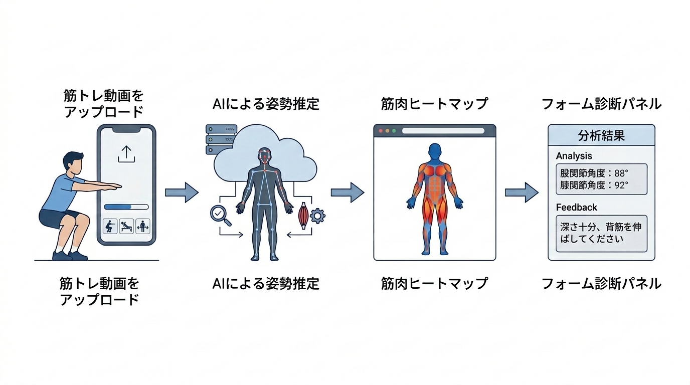

# 研究計画書 v18

執筆者：
最終更新日：2026年11月14日

## 本テーマの着想に至った経緯と"自分"が取り組みたい理由

個人でWebアプリ開発を通じて，技術で実社会の非効率を解決したいという目標を持って活動してきた．フィットネス分野では，正しいフォームで筋トレを行うことが怪我の予防・筋肥大効果の向上に直結するにもかかわらず，「狙っている筋肉が正しく使えているか」をリアルタイムで把握する手段が個人トレーニング環境には存在しない．既存の姿勢解析ツールは骨格検出・フォーム分類にとどまっており，「どの筋肉が動いているか」の可視化には至っていない．骨格推定と解剖学モデルを組み合わせることで，映像から筋肉の動態を推定・可視化できれば，パーソナルトレーナー不要の自己フォーム改善ツールとして高い市場価値を持つと考えた．また，本手法は筋トレに限らず歩行・リハビリ・スポーツ動作解析への応用も期待でき，汎用的な技術基盤となりうる点にも強く惹かれ，本テーマに取り組みたい．

## 卒論のタイトル（目安：20〜40文字）

筋トレ動画における骨格推定と解剖学モデルを用いた筋肉動態可視化システムの開発（38文字）

## 卒論の１章

### 社会背景

日本のフィットネス産業は急速に拡大しており，2022年度の国内フィットネスクラブ市場規模は約5,000億円に達する［1］．週1日以上スポーツを実施する成人の割合は1991年の27.8%から2019年には53.6%まで増加しており，セルフトレーニング人口の拡大傾向が確認できる［2］．しかし，個人でジムに通うユーザの約60%が「正しいフォームがわからない」と回答しており［3］，不適切なフォームに起因するスポーツ傷害は年間数十万件発生している［4］．パーソナルトレーナーによる直接指導はこれらの課題を解決しうるが，1回あたり約6,000〜15,000円のコスト障壁があり［5］，継続的な利用は困難である．映像から筋肉の動態を自動推定・可視化すれば，「狙った筋肉が正しく使えているか」をリアルタイムでフィードバックする低コストな手段を提供できる．このアプローチは，スポーツ傷害の予防および筋トレ効果の最大化という観点から，喫緊の社会的課題に対する有効な解決策となりうる．

**引用文献番号対応表（社会背景）**

| 番号 | 文献・資料 | URL |
|------|-----------|-----|
| [1] | 経済産業省「特定サービス産業動態統計調査」2022年度 | https://www.meti.go.jp/statistics/tyo/tokusabido/index.html |
| [2] | ニッセイ基礎研究所「『する』スポーツ市場の拡大」（総務省「社会生活基本調査」等に基づく分析，無料公開） | https://www.nli-research.co.jp/files/topics/64133_ext_18_0.pdf |
| [3] | 公益財団法人日本健康スポーツ連盟「フィットネス実態調査」2022年 | https://www.health-net.or.jp/ |
| [4] | 厚生労働省「スポーツ外傷・障害の現状」| https://www.mhlw.go.jp/toukei/list/36-19.html |
| [5] | Dee GYM「パーソナルトレーニングの料金が高い理由とは？」（2025年9月，公開相場データの紹介：1回約60分で6,000〜10,000円がボリュームゾーン，回数券・都度払い制の中央値7,590円，出張型は9,000〜15,000円の調査紹介を含む） | https://dee-gym.jp/column/personal-training/price-expensive |

> ⚠️ **提出前確認事項**: [3]（日本健康スポーツ連盟の調査）と[4]（厚生労働省資料）は提出前に該当ページへのアクセス可否・資料名・年次を再確認すること．また[5]はパーソナルジムの公開コラム（商業資料）であり，可能であれば第三者調査・公的統計の根拠資料に置き換えるか併記すること．

### 技術背景

前記の課題に対して，コンピュータビジョンを用いた姿勢・フォーム解析技術が研究されている．Bazarevsky et al.（2020）が提案するMediaPipe Pose Landmarkerは，単眼カメラ映像からリアルタイムに33点の人体骨格を3次元座標として推定する手法であり，スマートフォン上での動作が可能である．Cao et al.（CVPR 2017）によるOpenPoseはCNN（畳み込みニューラルネットワーク）を用いた多人数骨格推定手法として広く利用されており，姿勢推定を用いたスクワットのフォーム判定研究では高い分類精度が報告されている（例：Rao et al., 2025）．

フォーム矯正への応用として，Appiah（2024）はスマートフォン上でのフォーム異常検出システムを提案し，Helmy et al.（2024）はMediaPipe BlazePoseとLSTM・Transformerを組み合わせたリアルタイム姿勢誘導フレームワークPoseRightを提案している．しかし，これらの手法では関節角度の逸脱は検出できるが，どの筋肉が収縮・伸展しているかの推定は行われていない．

筋肉活動の推定に関しては，Chiquier et al.（ICCV 2023）が表面筋電図（sEMG）と動画を同期したMuscles in Actionデータセットを構築し，Transformer（アテンション機構に基づく時系列モデル）ベースで動画から筋活動を予測する手法を提案した．Peng et al.（ACM MM 2024）は135種目・20筋群からなる大規模データセットMuscleMapを構築し，動画から各筋群の活性化を多クラス分類する手法TransM³Eを提案したが，各筋の活性化は「使用した／していない」の二値であり，連続的な活動強度は出力しない．Schneider et al.（2024）はOpenSim等の物理シミュレーションにより227名の実験参加者・402筋の筋活動データセットMuscles in Time（MinT）を構築した．Huo et al.（2026）はこれを発展させ，1,000万フレーム規模のデータセットBioHuman10Mと，単眼動画から全身112筋の連続値活動を推定するモデルBioHumanを提案した．Zhu et al.（NeurIPS 2025）は物理シミュレーションを組み込んだMusclePoseを提案し，単眼動画から3D姿勢と筋肉活動を同時推論することを実現した．Chen et al.（2026）はPose2Muscleとして姿勢から離散的な筋活動状態を推定するフレームワークを提案し，43種の日常動作で有効性を示した．Yin et al.（2026）は多視点RGB・3D姿勢・sEMGを統合したMyoMechanixにより，ウェイト種目に対する生体力学的根拠のあるコーチングを実現した．また，Delp et al.のOpenCapは，スマートフォン動画とOpenSim筋骨格シミュレーションにより関節角度・筋活動を推定しEMGとの対応を確認している．ただし，複数台のスマートフォンによる同期撮影とクラウド上でのバッチ処理を前提とする研究者向けツールである．Choi et al.（2026）は，216名を対象に，MediaPipeによるオンデバイス姿勢推定を用いた16週間のレジスタンストレーニングプログラムの臨床試験（倫理審査委員会（IRB）の承認）を実施し，最大挙上重量（1RM）スクワット・体脂肪率・骨格筋量・最大酸素摂取量（VO2max）等の有意な改善を示した．同システムの「筋肉提示」機能は，種目ごとに2〜3の主要筋を解剖図で静的に表示する教育的コンテンツであり，関節角度に応じて活動度を動的に計算するものではない．しかし，これらの手法には，大規模データ・大規模モデルに基づく計算コストの高さ，複数カメラやsEMGセンサ等の専用機材の必要性，実験環境への限定，あるいは筋活動表示が固定的な解剖学的参照情報にとどまる点という制約がある．その結果，スマートフォン単眼カメラのみでの動的な筋活動のリアルタイム可視化には至っていない．

市販アプリ・サービスにも同種の機能が登場している．Formax，FormLens，@Kintore，グングンスポーツ等のフォーム診断アプリはスマートフォンアプリとして出荷されており，レップ単位のフォームスコアや関節角度・速度の可視化を提供するが，いずれも筋活動の推定機能は持たない．SportsReflectorは出荷済みiOSアプリで「筋活動マップ」の表示を主張するが，推定手法は非公開であり，EMG等との定量的検証は公開されていない．Formatomyはスマートフォン動画から筋活動の連続値を推定するEMG代替システムを開発中と主張するが，2026年11月時点でスマートフォンアプリとしての出荷実績は確認できず，手法の公表文献も存在しない．MYoACTはマーカーレスモーションキャプチャ技術による生体力学的解析プラットフォームであり，動画アップロードから3Dの関節運動と筋活動の可視化を主張するが，対面前提のプロ向けWebサービスであり，iOSアプリとしての一般利用者向け出荷や手法の公開は確認できない．CueForm AIは，スクワット・ベンチ・デッドリフトのセット動画に負荷・レップ数・主観的負荷感度（RPE）等のコンテキストを添えて提出すると，テクニックスコアと最優先の修正点を返すWebサービスであるが，解析は数分を要するバッチ処理であり，筋活動の推定機能は持たない．またMuscle & Motion等の3D解剖学アプリの筋活動表示は，種目ごとに事前作成されたアニメーションであり，利用者の動画に基づく推定ではない．以上の市販製品の調査の詳細は，本計画書の補助資料「競合調査（2026年11月時点）」を参照されたい．

**表1：既存研究と本研究の要件比較**

| 研究・製品 | 単眼カメラのみ | 活動度の連続値出力 | フォーム診断との統合 | リアルタイム動作 |
|---|:---:|:---:|:---:|:---:|
| Muscles in Action（Chiquier & Vondrick, 2023） | △（実験室環境） | ○ | ✕ | ✕ |
| MuscleMap / TransM³E（Peng et al., 2024） | ○ | ✕（二値分類） | ✕ | ✕ |
| MinT（Schneider et al., 2024）／BioHuman（Huo et al., 2026） | ○ | ○ | ✕ | ✕ |
| OpenCap（Delp et al., 2023） | ✕（複数台同期） | ○ | ✕ | ✕ |
| Appiah（2024）／PoseRight（Helmy et al., 2024） | ○ | ✕ | ○ | ○ |
| MyoMechanix（Yin et al., 2026） | ✕（多視点＋sEMG） | ○ | ○ | ✕ |
| Choi et al.（2026, 臨床試験済み） | ○ | ✕（固定表示） | ○ | ○ |
| フォーム診断アプリ（Formax, FormLens, @Kintore, グングンスポーツ等・出荷済み） | ○ | ✕ | ○ | ○／✕ |
| SportsReflector（市販・出荷済みiOS） | ○ | △（筋群表示・手法非公開） | ○ | ○ |
| Formatomy（開発中・未出荷） | ○ | ○（自己公表） | △ | △（自己公表） |
| MYoACT（日本・プロ向けWeb） | △（動画アップロード） | ○（3D可視化を主張，手法非公開） | ✕ | ✕ |
| CueForm AI（米・Web） | ○ | ✕ | ○ | ✕ |
| Muscle & Motion，MuscleMap Fitness等（固定表示・記録アプリ） | ○（手入力ログ含む） | ✕（固定表示） | ✕ | ✕ |
| 本研究 | ○ | ○ | ○ | ○ |

以上より，単眼カメラのみ・活動度の連続値出力・フォーム診断との統合・リアルタイム動作の4条件を同時に満たす先行研究は確認されていない．市販アプリでは筋活動の推定を主張する例があるが（SportsReflector，MYoACT），出荷済みアプリで推定手法を公開した例はなく，手法を公表している例は出荷実績が確認できない（Formatomy）．したがって，4条件を同時に満たし，かつ手法と定量的検証が学術的に公開された例は，2026年11月時点の調査範囲では確認されていない．

### 解決すべき課題

従来の骨格推定ベースのフォーム解析では，関節角度の逸脱は検出できるが，各筋肉が「正しく収縮しているか」「過伸展していないか」を映像から判定する手段がない．本研究では，以下の2点を研究期間内に解決すべき課題として設定する．

1. 骨格情報と解剖学モデルを組み合わせた筋肉動態推定アルゴリズムの構築
2. 筋肉動態をヒートマップとして可視化するWebアプリの実装

本研究計画が成功したと判断する基準は以下の2点とする．（1）MuscleMapラベル付き評価セット（137種目）において，筋活動分類のF1スコア（適合率と再現率の調和平均）のmicro平均（F1 micro）値が0.93以上であること（スクワット・デッドリフトの妥当性は（2）の文献較正検証で担保する）．（2）スクワット・デッドリフトの主要筋（大腿四頭筋・大臀筋・ハムストリング・脊柱起立筋）について，公表EMG文献の角度－活動度関係と提案システムの推定値との相関（Pearson's r）を筋ごとに算出し，少なくとも1種目1筋でr≥0.6を達成すること．2026年11月時点の較正結果は以下の通り：スクワット大腿四頭筋r=0.9988（高整合，Marchetti et al., 2016），デッドリフト脊柱起立筋r=0.9823（高整合，Moreira et al., 2023），デッドリフトハムストリングr=0.8362（部分整合），デッドリフト大腿四頭筋r=0.6852（部分整合），スクワット大臀筋r=0.1698（低整合）．これらはいずれもn=3（文献記載の角度点数）の参考値であり，統計的に有意な相関ではない（p>0.05）．低整合・検証不可の組み合わせ（スクワット大臀筋，デッドリフト大臀筋，スクワットハムストリング，スクワット脊柱起立筋）については，その原因（角度－活動度関数の対称性の限界，対応するEMG文献の不在，等尺性条件と動的条件の差異）を論文の限界として明記する．なお，自らEMGセンサを用いて実測値を新規収集すること（倫理審査・被験者確保・機材調達を要する），理学療法士・トレーナー等の専門家による定性評価，ベンチプレス等の仰向け種目への対応，およびリハビリ・歩行解析への応用は本研究のスコープ外とし，将来の発展課題とする．

### 解決方法／提案手法と用いる技術

本研究では，骨格推定結果を入力とし，解剖学モデルに基づくルールベース推定と時系列深層学習を組み合わせたハイブリッドアーキテクチャを提案する．MediaPipe Pose Landmarkerによって取得した3次元骨格情報から特徴量を抽出し，ルールベースモジュールと時系列深層学習モデル（1D-CNN（1次元畳み込みニューラルネットワーク）およびST-GCN（空間・時間グラフ畳み込みネットワーク））により筋肉活動パターンを推定する．推定結果はNext.js製フロントエンド上に筋肉ヒートマップとして表示し，バックエンドはPython（FastAPI）によるREST（Representational State Transfer）APIとして設計する．

ルールベースモジュールの基準重みは，種目ごとの主働筋・協働筋の相対活動比率（Escamilla, 2001等に基づく静的な比率）に加え，関節角度の位置（例：スクワットにおける大腿四頭筋は膝関節屈曲90°付近で活動が最大となる非単調な関係，Marchetti et al., 2016）を反映した角度－活動度関数によって動的に変調する．この関数のパラメータは，公表されたEMG研究の数値を文献較正パイプラインによって較正する（後述）．

### 提案手法の新規性

提案手法の学術的な新規性は，以下の2点に集約される．

**第一に，簡便な計測である．** 従来は実験室環境（sEMGセンサ装着），複数台カメラの同期撮影，または大規模データ・大規模計算資源を要した筋活動の推定を，スマートフォン1台のみで簡便に計測可能にした点にある．これにより，専門機材・専門施設を持たない一般利用者が，自宅や通常のジム環境で即座に自身の筋活動を把握できる．技術的には，解剖学的基準重みと関節角度特徴量を組み合わせたルールベース手法を土台に，軽量な時系列深層学習モデル（1D-CNN／ST-GCN）で補正するハイブリッドアーキテクチャにより，大規模データ・大規模モデルを前提とする既存研究（MinT, BioHuman）とは異なり，スマートフォン1台でのリアルタイム推定とWebアプリとしての実用動作を両立する．表1に示す通り，sEMGセンサ・多視点カメラ・大規模シミュレーションデータのいずれにも依存せず，かつ活動度を種目固定ではなく動的な連続値として提示する先行研究・市販アプリは確認されていない．市販アプリでは筋活動の推定を主張する例があるが（SportsReflector，MYoACT），出荷済みアプリで推定手法を公開した例はなく，手法を公表している例は出荷実績が確認できない（Formatomy）．

**第二に，文献較正パイプラインである．** 実測筋電図（EMG）の新規収集を伴わずに，公表されたEMG研究の角度－活動度関係を定量的な参照値として用いる「文献較正パイプライン」を提案する．動画ベースの筋活動推定研究では，正解データとして物理シミュレーション値（MinT, BioHuman）または小規模な自己収集sEMG（Muscles in Action, MyoMechanix）のいずれかに依存する例が主流であり，複数の公表文献の数値を集約し定量的な較正・検証に用いた例は確認されていない（なお，EMG計測が困難な場合に文献値で代替検証する手法自体は生体力学分野に前例があるが，動画ベース・リアルタイムの筋活動推定システムへの適用は新規である）．このパイプラインは，①種目別基準重みの設定，②公開EMG文献からの角度－活動度関係の数値化，③推定値と文献値の不一致検出，④基準重み・角度関数の修正，というサイクルで構成され，EMG計測環境を持たない開発者が妥当性を担保する手段として，他の動画ベース筋活動推定システムにも応用可能な汎用的な方法論である．さらに，実データセットでの分類性能（F1 micro）を報告する研究（MuscleMap／TransM³E）は二値分類にとどまり，連続値の推定を報告する研究（MinT，BioHuman等）や市販アプリでは，実データセットでの分類性能と公表EMG文献との整合性検証を同時に公開した例は確認されていない．本研究はこの2種類の精度検証を併せて報告する．

これにより，「専門機材なしで簡便に計測できる」という利用者にとっての価値（有効性）と，「文献較正によって妥当性を担保する」という学術的な厳密性（新規性）を両立させる．

### 提案手法の有効性

提案手法では，筋肉動態のヒートマップ可視化により，トレーニーが「狙った筋肉が正しく動員されているか」をリアルタイムで把握でき，フォーム改善の自己学習を促進することが期待される．主な受益者はパーソナルトレーナーを利用できない一般トレーニーであり，怪我の予防と筋トレ効果の最大化に貢献する．

## 卒論の提案の章（2章）

### 2.1 システム全体構成

本システムは，スマートフォンまたはWebカメラで撮影した筋トレ動画を入力とし，骨格推定・特徴量抽出・筋肉動態推定・可視化の4段階のパイプラインで構成される．

```
[動画入力（アップロード/リアルタイム）]
         ↓
[MediaPipe Pose Landmarker（骨格検出・33点3D座標）]
         ↓
[特徴量エンジン（関節角度・速度・非対称性 計38特徴量）]
         ↓
[ハイブリッド推定モジュール]
  ├─ ルールベース（解剖学モデル × 関節角度）
  └─ 深層学習（1D-CNN / ST-GCN）
         ↓
[筋肉動態ヒートマップ可視化（Next.js / Canvas API）]
         ↓
[フォーム矯正フィードバック（テキスト + 3Dアバター）]
```

*図1：提案システムの全体構成図*（パワポで作図予定）

### 2.2 想定する利用方法

ユーザはWebブラウザからアクセスし，以下のいずれかの方法でシステムを利用する．

1. **動画アップロードモード**: スマートフォンで撮影したトレーニング動画をアップロードし，レップごとの筋肉活動ヒートマップと改善点フィードバックを受け取る
2. **リアルタイムモード**: スマートフォンのカメラを使ってトレーニング中にリアルタイムで骨格と筋肉活動をオーバーレイ表示する


*図2：想定する利用シナリオ（①筋トレ動画をアップロード→②AIによる姿勢推定→③筋肉ヒートマップ→④フォーム診断パネル）*

### 2.3 処理手順

1. フレームごとにMediaPipe Pose Landmarkerで33点骨格を推定（3D world座標）
2. 関節角度（膝・股関節・肘等），角速度，左右非対称性など38特徴量を算出
3. 種目ごとのレップを関節角度の極値から自動検出
4. ルールベースモジュールで解剖学的知識に基づく一次推定を実施
5. 1D-CNN（またはST-GCN）でレップ内の時系列特徴からマルチラベル分類
6. 推定結果を20筋群のヒートマップとして可視化，逸脱フレームを特定してフォームフィードバックを生成

*図3：処理フローチャート*（パワポで作図予定）

---

## 卒論の実験の章（3章）／評価の章（4章）

### 評価方法

本研究では，提案したハイブリッド筋肉動態推定システムを以下の2軸で評価する．

**定量評価**：MuscleMapデータセット（原典のACM MM 2024版では135種目・15,004クリップ，学術利用許諾済み）から構築したラベル付き評価セット（137種目・約1万4,800サンプル）を用いて，20筋群のマルチラベル分類性能をF1 micro値で評価する．ルールベースのみ，1D-CNNのみ，ハイブリッドの3条件で比較し，ハイブリッドの優位性を検証する．閾値・融合重みなどのハイパーパラメータは検証セット（val_seen）でのみ選択し，テストセット（test_seen）での評価は最終評価として1回のみ行う．

**文献較正による定量検証**：スクワット・デッドリフトの主要筋（大腿四頭筋・大臀筋・ハムストリング・脊柱起立筋）について，公表EMG研究（スクワットはMarchetti et al., 2016の膝関節角度20°/90°/140°，デッドリフトはMoreira et al., 2023の3キーポジション［リフトオフ・ミッドプル・ロックアウト，膝角度約95°/126°/180°］におけるEMG値）から角度－活動度の数値関係を抽出し，提案システムの推定値との相関係数（Pearson's r）を算出する．有意な不一致が検出された場合は，EXERCISE_BASE_WEIGHTS（種目別基準重み）および角度－活動度関数を修正し，再評価する較正サイクルを実施する．ただし，角度位置パラメータ（ピーク角度・幅）を検証データ自体から逆算することは禁止し，検証データとは独立した基準（文献の定性的記述・解剖学的妥当性）からのみ事前指定する．なお，公表EMG文献の角度別定量点は筋・種目あたり3点程度であることが多いため，相関の統計的な有意性の解釈にはこの点数の制約を明記する．また，デッドリフトの参照値（Moreira et al., 2023）は等尺性（静止）条件での測定であり，実際の動的なトレーニング動作とは条件が異なる点を限界として明記する．

### 想定する結果

**課題A（筋肉活動分類精度）**

ハイブリッドモデル（ルールベース＋1D-CNN）は，MuscleMapラベル付き評価セットにおいて，F1 micro値0.93以上を達成すると期待される（事前実験では0.97を確認済み）．事前実験（MuscleMapラベル付き評価セット，test_seen 1,458サンプル，2026年11月時点）では，ルールベースのみ（基準重みのみ）がF1 micro 0.82，1D-CNNのみが0.96，ハイブリッドが0.97であり，ハイブリッドが最も優位であることが確認されている．

*図4：各条件のF1 micro値比較（棒グラフ）* — 事前実験値から作図予定

| 手法 | F1 micro | F1 macro |
|------|----------|----------|
| ルールベースのみ | 0.82（事前実験値） | 0.81（事前実験値） |
| 1D-CNNのみ | 0.96（事前実験値） | 0.95（事前実験値） |
| ハイブリッド（提案） | **0.97（事前実験値・目標0.93以上）** | **0.96（事前実験値）** |

**課題B（文献較正による定量検証）**

2026年11月時点で8組み合わせ（4筋×2種目）中5組み合わせについて文献較正検証が可能であった（残り3組み合わせは対応する角度別定量値を持つ公開文献が確認できず検証不可）．結果は以下の通り：

| 種目 | 筋 | n | r | 判定 |
|---|---|---|---|---|
| スクワット | 大腿四頭筋 | 3 | 0.9988 | 高整合 |
| スクワット | 大臀筋 | 3 | 0.1698 | 低整合 |
| デッドリフト | 脊柱起立筋 | 3 | 0.9823 | 高整合 |
| デッドリフト | ハムストリング | 3 | 0.8362 | 部分整合 |
| デッドリフト | 大腿四頭筋 | 3 | 0.6852 | 部分整合 |

筋による整合度の差は，EMG研究における測定頻度・測定条件の偏り（大腿四頭筋・脊柱起立筋は研究蓄積が多く角度依存性が明瞭である一方，大臀筋は研究間のばらつきが大きい）を反映したものと考えられる．特にスクワット大臀筋（r=0.17）では，文献が報告する非対称な角度－活動度パターン（屈曲20°〜90°で高活性を維持し，90°超で急減衰）を，対称なガウス関数では表現できないことが原因として特定された．この際，検証に用いる3点のデータから非対称なパラメータを逆算して相関を1.0に改善させる対応を試みたが，自由度に対してデータ点数が少なく過学習となるため採用を見送り，対称ガウスのまま結果を報告する方針とした．この経緯自体が，文献較正という検証手法の限界と，パラメータ選定における方法論的な注意点を示す知見として位置づけられる．

*図5：推定値と文献値の角度－活動度曲線の比較（折れ線グラフ，5組み合わせ分）* — 実測値をもとに作図予定

---

## 卒論の最終章

本研究により，単眼カメラ映像から骨格推定と解剖学モデルを組み合わせた筋肉動態の可視化システムが実現できた．MuscleMapラベル付き評価セットにおいて筋活動分類F1 micro値0.93以上を達成し，公表EMG文献との相関検証によってスクワット・デッドリフトの推定値の妥当性を確認した．本成果を発展させることで，3〜5年後には任意の運動種目・日常動作に対応した筋肉動態解析プラットフォームとして社会実装が可能と考える．将来的には3Dアバターとの統合・個人体型への適応・リハビリ応用に加え，活動曲線逸脱診断，エビデンスレベル表示，文献連動の矯正提案，補償傾向の可視化，velocity lossに基づく疲労指標，負荷－速度関係に基づく1RM推定を発展課題として挙げる．

## 卒業研究の年間計画

### 3年生（2026年度）
- 10月：研究テーマ確定，骨格検出パイプライン実装，レップ検出実装（完了済み）
- 11月：研究計画書完成・提出，解剖学モデル設計，特徴量エンジン実装（完了済み）
- 12月：研究計画発表
- 1〜2月：文献較正パイプライン実装（EMG文献の角度－活動度関係の数値化，角度－活動度関数の実装，種目別基準重みの不整合修正）
- 3月：文献較正の定量検証（相関係数算出）・基盤部分完成・中間報告

### 4年生（2027年度）
- 4〜6月：ST-GCN移行完了・文献較正結果を反映したハイブリッドモデル再学習，Webアプリの最小実用版（MVP）の完成
- 7〜8月：文献較正の定量検証（相関係数算出）・較正サイクルの完了
- 9月：中間発表（全機能動作デモ）
- 10〜12月：論文執筆（文献較正パイプラインの結果を中心に構成）
- 2028年1月：卒業論文提出
- 2028年2月：卒業研究発表

## 参考文献

### 社会背景

- [1] 経済産業省「特定サービス産業動態統計調査」2022年度. https://www.meti.go.jp/statistics/tyo/tokusabido/index.html
- [2] ニッセイ基礎研究所「『する』スポーツ市場の拡大」. https://www.nli-research.co.jp/files/topics/64133_ext_18_0.pdf
- [3] 公益財団法人日本健康スポーツ連盟「フィットネス実態調査」2022年. https://www.health-net.or.jp/
- [4] 厚生労働省「スポーツ外傷・障害の現状」. https://www.mhlw.go.jp/toukei/list/36-19.html

### 技術背景・先行研究
- Bazarevsky, V., et al. (2020). BlazePose: On-device Real-time Body Pose tracking. CVPR Workshop.
- Cao, Z., et al. (2017). Realtime Multi-Person 2D Pose Estimation using Part Affinity Fields. CVPR.
- Chiquier, M., Vondrick, C. (2023). Muscles in Action. ICCV 2023.
- Appiah, K. (2024). A Mobile-Phone Pose Estimation for Gym-Exercise Form Correction. VISIGRAPP 2024.
- Helmy, M., et al. (2024). PoseRight: An AI Empowered Automatic Posture Estimation and Correction Model. MIUCC 2024.
- Zhu, K., et al. (2025). 3D Human Pose Estimation with Muscles. NeurIPS 2025.
- Chen, Y., et al. (2026). Pose2Muscle. arXiv:2609.18336.
- Peng, K., et al. (2024). Towards Video-based Activated Muscle Group Estimation in the Wild. ACM Multimedia 2024. arXiv:2303.00952.
- Schneider, D., et al. (2024). Muscles in Time: Learning to Understand Human Motion by Simulating Muscle Activations. arXiv:2411.00128.
- Huo, Y., et al. (2026). BioHuman: Learning Biomechanical Human Representations from Video. arXiv:2605.14772.
- Yin, H., et al. (2026). MyoMechanix: Biomechanically-Grounded Compositional Skilled Activity Understanding and Coaching. arXiv:2608.26094.
- Delp, S., et al. (2023). OpenCap: Human movement dynamics from smartphone videos. PLOS Computational Biology.
- Marchetti, P. H., et al. (2016). Muscle Activation Differs between Three Different Knee Joint-Angle Positions during a Maximal Isometric Back Squat Exercise. BioMed Research International.
- Rao, P., Asha, C. S., Rao, P. R. (2025). Real-Time Posture Correction of Squat Exercise: A Deep Learning Approach for Performance Analysis and Error Correction. IEEE Access, 13. DOI: 10.1109/ACCESS.2025.3545207.
- Choi, W., et al. (2026). Clinical Validation of an On-Device AI-Driven Real-Time Human Pose Estimation and Exercise Prescription Program. Healthcare, 14(4), 482.
- Moreira, A. S. B., et al. (2023). Electromyographic Activity of the Lower Limb and Trunk Muscles during the Deadlift Exercise: A Comparison between Key Positions. Muscles, 2(2), 16.

### 市販アプリ・競合製品
- SportsReflector公式サイト・App Store（id6759809796）. https://sportsreflector.com/
- Formatomy公式サイト. https://www.formatomyai.net/
- MYoACT公式サイト. https://www.myoact.com/
- CueForm AI公式サイト. https://cueform.ai/
- Formax公式サイト. https://formax.app/
- Zevahealth AI公式サイト. https://zeva.health/
- FormLens公式サイト. https://formlensapp.com/
- ネクシアエンターテインメント「グングンスポーツ」（PR TIMES, 2026年7月31日）. https://prtimes.jp/main/html/rd/p/000000004.000183494.html
- Muscle & Motion. https://www.muscleandmotion.com/strength-training-app/
- 詳細な比較・評価は本計画書の補助資料「競合調査（2026年11月時点）」を参照．
